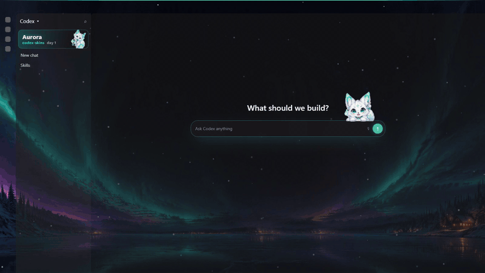
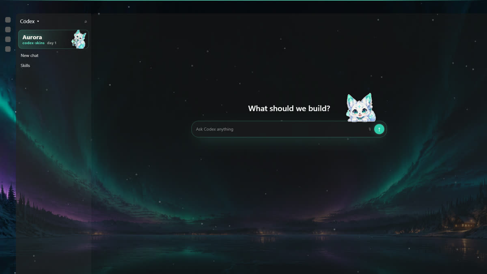
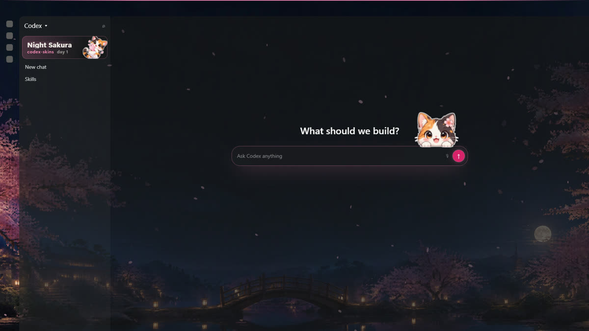
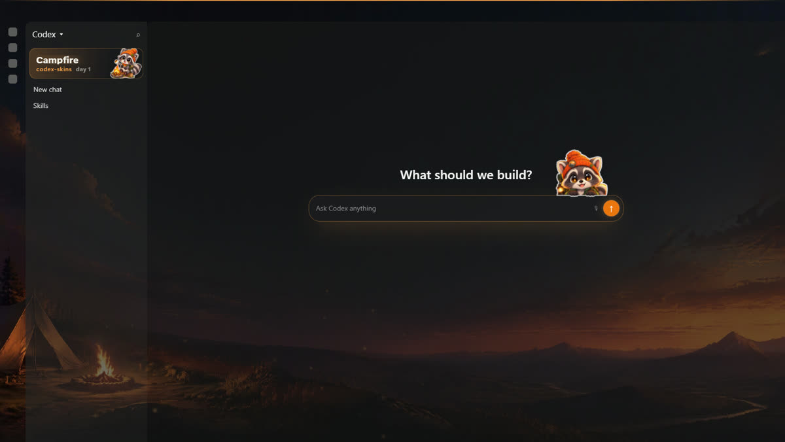
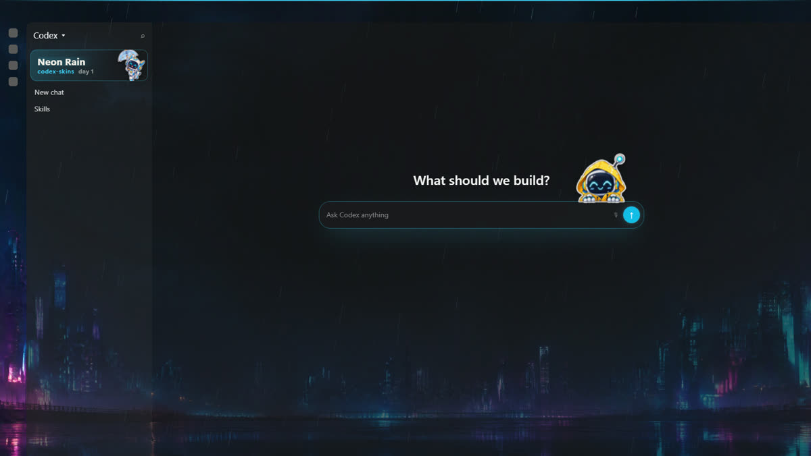

<h1 align="center">codex-skins</h1>

<p align="center"><b>Themes and a typing mascot for the Codex desktop app — Windows and macOS.</b><br>
<sub>A painted scene behind your chats, the accent recolored to match, frosted glass, gentle particles — and a little mascot that peeks over your message box, hops along as you type and jumps when you hit Enter.</sub></p>

<p align="center">
  <a href="https://github.com/JIA-ss/codex-skins/actions/workflows/ci.yml"></a>
  <a href="https://github.com/JIA-ss/codex-skins/releases/latest"></a>
  <a href="LICENSE"></a>
  <a href="skins/LICENSE.md"></a>
  <a href="#install"></a>
  <a href="https://nodejs.org">= 22"></a>
  <a href="https://github.com/JIA-ss/codex-skins/stargazers"></a>
  <a href="https://github.com/JIA-ss/claude-skins"></a>
</p>

<p align="center"><a href="README.zh-CN.md">中文说明</a> · <a href="#install">Install</a> · <a href="#using-it">Shortcuts</a> · <a href="#make-your-own-theme">Make a theme</a> · <a href="https://github.com/JIA-ss/claude-skins">claude-skins (for Claude)</a></p>

<p align="center"></p>

> [!NOTE]
> **Unofficial.** codex-skins is an unofficial community project. It is not made, endorsed or supported by OpenAI. It patches the copy of Codex installed on <i>your</i> machine; no OpenAI files are redistributed here. Use it at your own risk, and expect to re-run the installer after Codex updates.

| Aurora | Night Sakura | Campfire | Neon Rain |
|---|---|---|---|
|  |  |  |  |

## Install

Windows and macOS. Requires [Node.js](https://nodejs.org) 22+.

```bash
git clone https://github.com/JIA-ss/codex-skins.git
cd codex-skins
npm install --omit=dev   # dev dependencies (Electron) are only needed for the tests
node install.mjs
```

Then start Codex from the new Start menu shortcut **Codex (skins)** (Windows), or **Codex (skins)** in `~/Applications` / Spotlight (macOS).

What the installer does: Codex comes from the Microsoft Store (MSIX), whose folder is read-only, so it copies the app to `%LOCALAPPDATA%\codex-skins\Codex`, patches the copy and adds the shortcut. The regular Codex is never modified and can keep running next to it.

- Your login, chats and projects live in `~/.codex` and are shared by both.
- The copy has its own UI profile (window layout, local settings), otherwise starting it would just bring up the regular app's window.
- `codex://` links still open the regular app.

**macOS:** the signed `/Applications/ChatGPT.app` (bundle `com.openai.codex`) is never touched — patching it in place would break OpenAI's signature and its auto-update. The installer copies it to `~/Applications/Codex (skins).app`, gives the copy its own UI profile (`~/Library/Application Support/CodexSkins`), turns the fuses off in `Frameworks/Codex Framework.framework` and re-signs the copy ad hoc. macOS may ask once whether the copy may control other apps (Codex's computer-use helper); that is Codex's own feature, answer as you like. Shortcuts are ⌃⌥T / ⌃⌥⇧T / ⌃⌥P. Tested on macOS 26 (Apple silicon) with Codex 26.1023.

Other commands:

```bash
node install.mjs status      # where Codex is, whether the copy is patched
node install.mjs uninstall   # delete the skinned copy and its shortcut (its UI profile %APPDATA%\Codex\web\CodexSkins stays; delete it by hand if you like)
node install.mjs --app <dir> # patch some other unpacked Codex folder (one with resources/app.asar) in place
```

**After Codex updates**, quit the skinned copy and run `node install.mjs` again — it notices the new version and takes a fresh copy.

## Using it

| | |
|---|---|
| `Ctrl+Alt+T` | next theme (… → off → first theme) |
| `Ctrl+Alt+Shift+T` | intensity: how much of the scene shows through (low / medium / high) |
| `Ctrl+Alt+P` | **stage mode** for screen recordings: hides the sidebar contents (chats, projects, account) and the conversation titles in the tab strip, and skips themes marked `"private": true`. Press again to turn it off; it stays on across restarts until you do. |
| click the sidebar banner | next theme (it sits right above **New chat**) |

The mascot:

- **Typing** — every keystroke it nods and takes a step along the top of the message box. Type faster and it builds momentum: longer strides, leaning forward, little dust puffs. Keep a streak going for a combo counter, random crits and callouts at 20 / 50 / 100 keys; your best streak is remembered.
- **Enter** — crouches and jumps; the more momentum, the higher (and a flip at full speed).
- **Click** — boing / head shake / hop with a speech bubble; three quick clicks make it dizzy.
- **Drag** — grab it anywhere, it swings with your movement and stays where you drop it. Drop it back near the message box (or double-click it) and it climbs back home, at the right end of the box.
- Clicks on its transparent parts go straight through to the page.

Light theme: only the accent color changes (the scenes are designed for dark mode). Reduced motion (OS setting) turns off animations and particles.

## Make your own theme

A theme is a folder with a `skin.json` — the same format as [claude-skins](https://github.com/JIA-ss/claude-skins#make-your-own-theme):

```json
{
  "name": { "en": "Aurora", "zh": "极光" },
  "order": 1,
  "hue": 168, "sat": 62,
  "line": "#5fe3c4",
  "background": "background.jpg",
  "peek": "peek.png",
  "badge": "badge.png",
  "fx": "snow", "fxColor": "#e6f7ff"
}
```

| Field | Meaning |
|---|---|
| `name` | string, or `{ "en", "zh" }` |
| `hue`, `sat` | accent color (HSL hue / saturation; lightness is kept from your Codex accent) |
| `line` | highlight color for rings, the top line, bubbles |
| `background` | wide image (21:9 works well, e.g. 3840×1632). Keep the **center dark and empty** — text sits there. Omit for a generated gradient. |
| `peek` | transparent PNG of the mascot peeking over an edge (bottom edge flat). Omit for no mascot. |
| `badge` | transparent PNG for the sidebar banner |
| `fx` | particles: `snow`, `petals`, `embers`, `rain`, `spores`, or omit |
| `font` | optional `.woff2` / `.ttf` used for the banner title, bubbles and combo counter |
| `lines` | optional speech lines: `{ "click": [...], "drag": [...], "send": [...], "dizzy": [...], "home": [...], "crit": [...], "tiers": [4 callouts for 20/50/100/200 combos] }`, or per language `{ "zh": {...}, "en": {...} }` |
| `tag` | small text under the theme name in the sidebar banner (default `codex-skins`) |
| `default` | `true` to make it the theme used on first start |
| `private` | `true` to hide it in stage mode (e.g. a theme with internal / licensed art you should not show in recordings) |

Two ways to add it:

- **No reinstall:** put the folder in the skinned copy's user data folder under `codex-skins/skins/<id>/` and restart Codex:
  Windows `%APPDATA%\Codex\web\CodexSkins\codex-skins\skins\`, macOS `~/Library/Application Support/CodexSkins/codex-skins/skins/`. A folder with the same id as a built-in theme replaces it.
- **Bundle it:** `node install.mjs --skins <folder containing theme folders>` (repeatable).

`<id>` is the folder name: lowercase letters, digits and `-`.

**Your own icons:** `node install.mjs --icons <dir>` copies `chatgpt-app-dark.ico` / `chatgpt-app-light.ico` from `<dir>` over the copy's window icons (Codex picks one by the taskbar's light / dark mode) and uses `shortcut.ico` for the Start menu shortcut — handy to tell the skinned copy from the regular app.

## How it works

The installer unpacks Codex's `resources/app.asar`, adds two things and packs it again (the native files that live outside the archive are checked to be byte-identical):

- `src/main.js` is required at the very top of the app's main entry. It answers three IPC calls — list themes, read a theme file, write a diagnostics file — and only for Codex's own UI (served from `app://-/`), not for embedded web pages.
- `src/deco.js` + `src/preload.js` are appended to the main window's preload. They draw the scene on a canvas behind the page, turn the big opaque main surface semi-transparent so the scene shows through (cards, code blocks and inputs keep their background), recolor the accent, and add the mascot, banner, glass and particles. Images are decoded from bytes, so the page's Content Security Policy is untouched.

The accent: Codex has its own theme engine — four inputs (accent, ink, surface, contrast) expanded into a full set of CSS variables. codex-skins reads the accent (`--codex-base-accent`) and its darker shade (`--color-background-accent-action`, used by the send button), swaps every variable whose value contains them for the theme's hue and saturation (keeping lightness), and re-mixes the accent-tinted backgrounds. Danger colors, the plain orange palette and on-accent text are left alone.

Codex runs on OpenAI's own Electron-compatible runtime ("owl"). Its Electron fuses live in `chrome.dll`, not in the executable; the installer turns off `EnableEmbeddedAsarIntegrityValidation` and `OnlyLoadAppFromAsar` there so the modified archive loads. Backups of everything it changes sit next to the originals as `*.codex-skins-orig`.

Everything is written to fail quietly: if Codex changes its markup, the worst case is that the mascot or the accent stops showing up — the app itself keeps working.

## Troubleshooting

- **Nothing changed** — make sure you started the copy (the **Codex (skins)** shortcut), and that it was not running while you installed. `node install.mjs status` should say `patched: yes`.
- **Scene shows but the accent doesn't change, or the mascot / banner is missing** — Codex probably changed. Look at `%APPDATA%\Codex\web\CodexSkins\codex-skins\probe.json` (`accents`, `hooks`, `seeThrough`) and open an issue with it.
- **The shortcut opens the regular Codex window** — the copy's UI profile must differ from the regular app's; check `UserDataDirectoryName` in `resources\owl-app.ini` of the copy (`--profile <name>` sets it).
- **Codex won't start after patching** — `node install.mjs uninstall`, then open an issue with your Codex version.

## Develop

```bash
npm test        # unit tests + an Electron end-to-end test on a mock of the Codex main window
npm run e2e     # only the end-to-end test; screenshots in test/out/
npm run demo    # re-record docs/demo.mp4 + docs/demo.gif + docs/theme-*.jpg (needs ffmpeg)
npm run e2e -- --skins <dir>   # also load and test your own theme folders
```

The end-to-end test runs the real preload in Electron against `test/e2e/app/page.html`, a mock that reproduces just the hooks codex-skins relies on (the theme engine's variables, a transparent window over an opaque main surface, the sidebar's per-mode nav groups, `[data-composer-body]`, the tab strip), and drives keys and the mouse: every theme, see-through, accent swap (and that danger / plain orange / on-accent colors are left alone), banner placement, typing / walking speed, Enter jump, combos, click-through, drag and snap-back, intensity, stage mode and the diagnostics file.

`test/live.mjs` runs the same kind of checks against the **real** installed app: start the copy with `--remote-debugging-port=9339`, run `node test/live.mjs`, then restart Codex normally.

For your own build pipeline, `lib/patch.mjs` exports `injectInto(extractedAsarDir, { skinDirs })`.

## See also

- [claude-skins](https://github.com/JIA-ss/claude-skins) — the same themes and mascot for the Claude desktop app. Theme folders work in both.

## Credits

Code: MIT, see [LICENSE](LICENSE). The bundled theme art (backgrounds and mascots) comes from claude-skins: generated with an image model from text prompts only — no reference images — and released under [CC0](https://creativecommons.org/publicdomain/zero/1.0/) (see [skins/LICENSE.md](skins/LICENSE.md)). The prompts are in [tools/gen_art.py](tools/gen_art.py).

## Legal notice

> This is an **unofficial community project**, not affiliated with, endorsed by or sponsored by OpenAI. It contains no OpenAI code or assets: the installer modifies the copy of Codex already installed on your machine. "OpenAI", "ChatGPT" and "Codex" are trademarks of OpenAI. Use it at your own risk.

---

<p align="center"><sub>Made by <a href="https://github.com/JIA-ss">JIA-ss</a> · code MIT · theme art CC0</sub></p>
